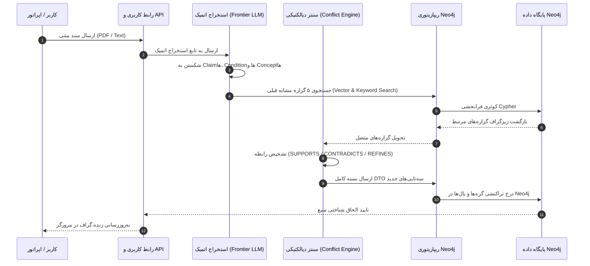
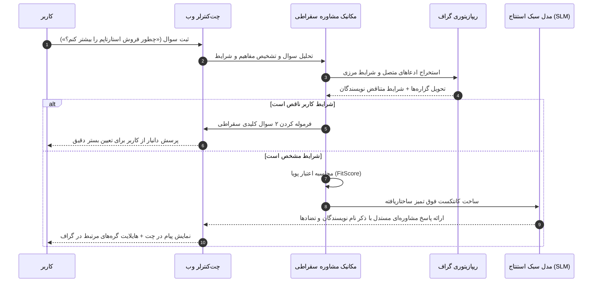

# سند معماری سامانه دانیار (System Architecture Specification)

**نسخه:** 1.0.0  
**پروژه:** دانیار (Danyar Engine)  
**وضعیت:** مصوب فاز ۲ (Gate 2 Approved)  
**استاندارد حاکم:** معماری لایه‌ای سخت‌گیرانه (Strict Layered Architecture Contract)  

---

## ۱. اصول بنیادین و فلسفه معماری (Architectural Philosophy)

معماری سامانه دانیار بر ۴ اصل مهندسی استوار است:

1. **تفکیک مطلق لایه‌ها و وارونگی وابستگی (Inversion of Control - IoC):**  
   هیچ ماژولی حق ندارد وابستگی مستقیم به کتابخانه‌های زیرین، درایور دیتابیس یا فریم‌ورک‌های وب داشته باشد. تعامل تمام اجزا صرفاً از طریق قراردادهای انتزاعی موجود در لایه `src/contracts/` انجام می‌شود.
2. **یک فایل، یک وظیفه منطقی (One File, One Logical Action):**  
   هر فایل در لایه‌های `mechanics/` و `utils/` باید دقیقاً یک تابع خالص (Pure Function) یا یک کلاس تک‌مسئولیتی را خروجی دهد تا اصطکاک بازبینی کد و باگ‌های جانبی به صفر برسد.
3. **جداسازی کامل پایگاه داده گرافی (Database Encapsulation):**  
   کدهای کسب‌وکار و الگوریتم‌های دیالکتیکی هرگز به جلسات Neo4j، درایورها یا کوئری‌های خام دسترسی ندارند. ورود و خروج داده به پایگاه داده منحصراً از طریق ریپازیتوری‌ها و با استفاده از DTOها (Data Transfer Objects) صورت می‌پذیرد.
4. **توسعه آزمون‌محور (Test-Driven Development - TDD):**  
   برای تضمین عدم وجود باگ و پایداری ۱۰۰٪، هیچ کدی در لایه‌های مکانیک یا دیتابیس بدون تست واحد متناظر در پوشه `tests/` تایید نمی‌شود.

---

## ۲. چیدمان فیزیکی مخزن و ساختار دایرکتوری‌ها (Directory Blueprint)

```text
src/
├── contracts/               # پروتکل‌ها و واسط‌های کاملاً انتزاعی (ZERO Runtime Logic)
│   ├── extraction_contract.py
│   ├── dialectic_contract.py
│   ├── credibility_contract.py
│   ├── advisor_contract.py
│   └── repository_contract.py
│
├── config/                  # تنظیمات ایستا و متغیرهای محیطی بدون منطق شرطی
│   ├── app_config.py
│   ├── neo4j_config.py
│   └── llm_config.py
│
├── core/                    # کانتینر تزریق وابستگی و ارکستراتور بوت‌استرپ
│   ├── container.py
│   └── orchestrator.py
│
├── entities/                # مدل‌های دامنه خالص فاقد وابستگی به دیتابیس یا UI
│   ├── source_entity.py
│   ├── author_entity.py
│   ├── claim_entity.py
│   ├── condition_entity.py
│   ├── outcome_entity.py
│   ├── synthesis_entity.py
│   └── user_note_entity.py
│
├── mechanics/               # الگوریتم‌های محاسباتی قطعی (Pure Functions)
│   ├── extract_atomic_claims.py
│   ├── resolve_canonical_concepts.py
│   ├── evaluate_dialectical_conflict.py
│   ├── calculate_dynamic_credibility.py
│   ├── compile_structured_context.py
│   └── formulate_socratic_inquiry.py
│
├── database/                # ایزولاسیون کامل Neo4j
│   ├── models/              # تعاریف ساختار نودها و روابط گرافی
│   │   ├── graph_nodes.py
│   │   └── graph_relationships.py
│   ├── dto/                 # اشیاء انتقال داده فرامرزی
│   │   ├── claim_ingest_dto.py
│   │   ├── graph_subgraph_dto.py
│   │   └── user_note_dto.py
│   ├── queries/             # کوئری‌های بهینه و پارامتری‌شده Cypher
│   │   ├── cypher_ingestion.py
│   │   ├── cypher_traversal.py
│   │   └── cypher_annotations.py
│   └── repositories/        # پیاده‌سازی قراردادهای دیتابیس
│       ├── neo4j_graph_repository.py
│       └── neo4j_annotation_repository.py
│
├── ui/                      # لایه ارائه و رابط‌های ورودی/خروجی
│   ├── api/                 # اندپوینت‌های وب (FastAPI Routers)
│   │   ├── chat_router.py
│   │   ├── graph_router.py
│   │   └── notes_router.py
│   ├── static/              # رابط کاربری وب تک‌صفحه‌ای (SPA)
│   │   ├── index.html
│   │   ├── css/
│   │   │   └── danyar_theme.css
│   │   └── js/
│   │       ├── graph_visualizer.js   # مبتنی بر 3d-force-graph
│   │       ├── markdown_editor.js    # مبتنی بر Milkdown
│   │       └── chat_controller.js
│   └── presenters/          # فرمت‌دهنده‌های پاسخ‌های فارسی و مارک‌داون
│       ├── socratic_presenter.py
│       └── graph_dto_presenter.py
│
└── utils/                   # ابزارهای عمومی و کراس‌کاتینگ
    ├── text_normalizer.py   # نرمال‌سازی نویسه‌های فارسی و حذف نیم‌فاصله‌های نامعتبر
    ├── schema_validator.py  # اعتبارسنجی خروجی‌های ساختاریافته JSON
    └── logger.py            # لاگر ردیابی رویدادهای سیستم
```

---

## ۳. چرخه حیات داده از ورودی تا خروجی (End-to-End Data Lifecycle)

### مسیر اول: بلع منبع جدید (Ingestion Pipeline)


### مسیر دوم: مشاوره سقراطی به کاربر (Socratic Advisory Flow)


---

## ۴. مشخصات قراردادهای لایه اینترفیس (`src/contracts/`)

### ۱. قرارداد استخراج (`IExtractionPipeline`)
```python
from abc import ABC, abstractmethod
from src.entities.source_entity import SourceEntity
from src.entities.claim_entity import ClaimEntity

class IExtractionPipeline(ABC):
    @abstractmethod
    def extract_from_text(self, source: SourceEntity, raw_text: str) -> list[ClaimEntity]:
        """تبدیل متن خام منبع به لیستی از گزاره‌های اتمیک کامپکت بدون ابهام"""
        pass
```

### ۲. قرارداد تحلیل تعارض دیالکتیکی (`IDialecticalSynthesizer`)
```python
from abc import ABC, abstractmethod
from src.entities.claim_entity import ClaimEntity
from src.entities.synthesis_entity import SynthesisResultEntity

class IDialecticalSynthesizer(ABC):
    @abstractmethod
    def analyze_relationship(self, new_claim: ClaimEntity, existing_claims: list[ClaimEntity]) -> list[SynthesisResultEntity]:
        """تشخیص یال‌های SUPPORTS، CONTRADICTS و REFINES با شواهد و دلایل قطعی"""
        pass
```

### ۳. قرارداد محاسبه اعتبار پویا (`ICredibilityCalculator`)
```python
from abc import ABC, abstractmethod
from src.entities.claim_entity import ClaimEntity
from src.entities.condition_entity import ConditionEntity

class ICredibilityCalculator(ABC):
    @abstractmethod
    def compute_fit_score(self, claim: ClaimEntity, user_context: ConditionEntity) -> float:
        """محاسبه وزن نهایی گزاره بر اساس میزان انطباق شرایط با موقعیت واقعی کاربر"""
        pass
```

### ۴. قرارداد ریپازیتوری گرافی (`IGraphRepository`)
```python
from abc import ABC, abstractmethod
from src.database.dto.claim_ingest_dto import ClaimIngestDTO
from src.database.dto.graph_subgraph_dto import SubGraphDTO

class IGraphRepository(ABC):
    @abstractmethod
    def save_claim_cluster(self, dto: ClaimIngestDTO) -> bool:
        """ثبت اتمیک یک خوشه ادعا شامل نودها و روابط استنتاجی در Neo4j"""
        pass

    @abstractmethod
    def fetch_related_subgraph(self, concept_names: list[str]) -> SubGraphDTO:
        """واکشی زیرگراف معنایی مرتبط در کمترین زمان ممکن"""
        pass
```

---

## ۵. طراحی پایگاه داده گرافی (Neo4j Schema & Indexing Strategy)

### ایندکس‌ها و قیدهای یکتایی (Constraints & Indexes)
برای تضمین سرعت پاسخ زیر ۵۰ میلی‌ثانیه، ایندکس‌های زیر در لحظه راه‌اندازی ساخته می‌شوند:
1. `CREATE CONSTRAINT FOR (c:Concept) REQUIRE c.name IS UNIQUE;`
2. `CREATE CONSTRAINT FOR (s:Source) REQUIRE s.id IS UNIQUE;`
3. `CREATE CONSTRAINT FOR (a:Author) REQUIRE a.id IS UNIQUE;`
4. `CREATE INDEX claim_statement_fulltext FOR (c:Claim) ON EACH [c.statement];`
5. `CREATE VECTOR INDEX claim_embedding_idx FOR (c:Claim) ON (c.embedding) OPTIONS {dimension: 768, similarityFunction: 'cosine'};`

---

## ۶. یکپارچه‌سازی رابط کاربری وب (UI Integration)

* **بوم گراف (Graph Visualizer):** ماژول `graph_visualizer.js` با استفاده از `vasturiano/3d-force-graph` مستقیماً داده‌های ساختاریافته JSON را از اندپوینت `/api/graph/subgraph` واکشی کرده، رنگ یال‌های `CONTRADICTS` را با رنگ نئونی سرخابی و `SUPPORTS` را با سبز فیروزه‌ای ترسیم می‌کند.
* **ویرایشگر کارت‌ها (Card Editor):** ماژول `markdown_editor.js` مبتنی بر `Milkdown` بوده و با کلیک روی هر گره، متن خام نود را به صورت مارک‌داون فرمت‌شده باز کرده و تغییرات یا یادداشت‌های کاربر را به اندپوینت `/api/notes/annotate` ارسال می‌کند.

---

## ۷. استراتژی تست و تضمین کیفیت (TDD Verification)

تست‌های واحد و اعتبارسنجی در پوشه `tests/` سازماندهی می‌شوند:
* `tests/unit/mechanics/`: آزمون بدون باگ توابع خالص و فرمول وزن‌دهی اعتبار پویا.
* `tests/unit/contracts/`: آزمون انطباق تایپ‌ها و پروتکل‌ها با اعتبارسنج Pydantic.
* `tests/integration/database/`: آزمون تراکنشی ثبت و واکشی از دیتابیس Neo4j با رول‌بک خودکار.
