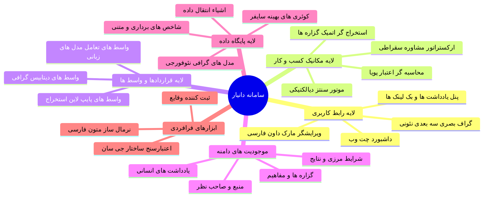
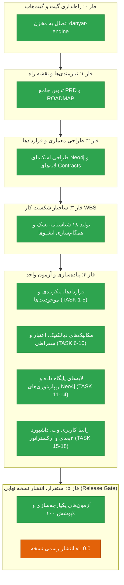

# نقشه راه و دیاگرام ذهنی سامانه دانیار (Danyar System Roadmap & Mind Map)

## ۱. نقشه ذهنی کلان سیستم (System Mind Map)

---

## ۲. وضعیت فازهای چرخه حیات توسعه (Component Implementation Status)

---

## ۳. پیشرفت نقاط عطف کلیدی (Milestone Progress)

- [x] **نقطه عطف ۰:** راه‌اندازی و اتصال مخزن در گیت‌هاب (`Armin-MA/danyar-engine`)
- [x] **نقطه عطف ۱:** تصویب کامل سند نیازمندی‌ها (PRD) و نقشه راه در Gate 1
- [x] **نقطه عطف ۲:** قفل معماری لایه‌ای، قراردادها (`contracts/`) و اسکیمای دیتابیس در Gate 2
- [x] **نقطه عطف ۳:** تدوین WBS، تولید شناسنامه تسک‌ها (`tasks/TASK-XXX.md`) و اتصال به ۱۸ ایشیو گیت‌هاب
- [x] **نقطه عطف ۴:** اتمام کامل پیاده‌سازی تمام ۱۸ تسک با روش TDD، پاس شدن ۱۵۸ تست واحد، بسته شدن تمامی ایشیوها و مایلستون ۴
- [ ] **نقطه عطف ۵:** انتشار رسمی و برچسب‌گذاری نسخه پایدار `v1.0.0` (Release Gate)
